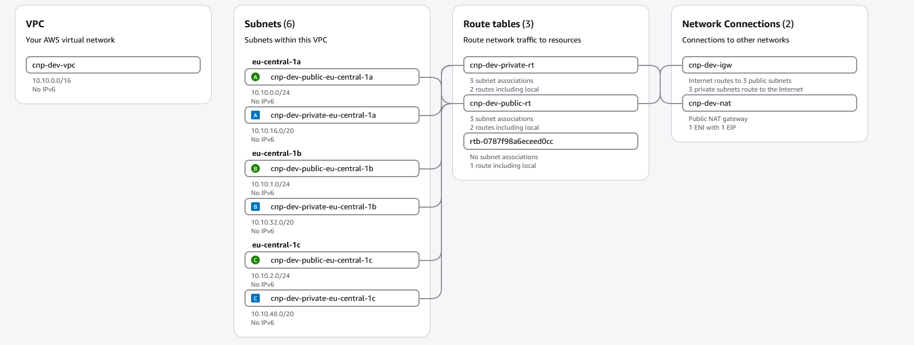

# Cloud-Native Platform on AWS

A production-style Kubernetes platform on AWS, built end to end as code: infrastructure with Terraform, CI with GitHub Actions and security scanning, GitOps delivery with Argo CD, and observability, backup and cost control on top. The workload is Google's [Online Boutique](https://github.com/GoogleCloudPlatform/microservices-demo), an 11-service microservices shop.

> **Status:** 🚧 Work in progress (Oct 2026 – Jan 2027). See [Roadmap](#roadmap) and [DEVLOG](DEVLOG.md).

## Goals

- Provision all AWS infrastructure with Terraform – reproducible `apply` and `destroy`, two environments (dev, prod) from the same modules
- Ship code from `git push` to production without manual steps: build → scan → push → GitOps sync
- No long-lived credentials anywhere: OIDC for CI, IAM roles for pods, secrets from AWS Secrets Manager
- Operate the platform: metrics, logs, alerts, runbooks, backup & restore, cost monitoring

## Architecture

```
Developer ──git push──► GitHub ──► GitHub Actions: build · Trivy scan · push to ECR · bump image tag
                           │
                           └──► Argo CD (in EKS) pulls desired state from Git ──► Online Boutique (Helm)

AWS eu-central-1 (Terraform): VPC (public/private subnets) · EKS · ECR · IAM/OIDC · S3 · Secrets Manager · Lambda
In-cluster: Argo CD · Prometheus/Alertmanager · Grafana · Loki · Velero · External Secrets · NetworkPolicies
```

### Network (dev)

VPC `10.10.0.0/16` across three Availability Zones, created by the reusable [`vpc` module](terraform/modules/vpc/): public subnets for load balancers and the NAT gateway, private subnets for EKS nodes and pods. Design rationale in [ADR 0003](docs/adr/0003-network-design.md).



More diagrams in [`docs/diagrams/`](docs/diagrams/).

## Tech Stack

| Area | Tools |
|---|---|
| Infrastructure as Code | Terraform, tflint, Checkov |
| Cloud | AWS – VPC, EKS, ECR, IAM, S3, Secrets Manager, Lambda, SNS |
| Containers & Orchestration | Docker, Kubernetes (EKS; kind for local development), Helm |
| CI / CD | GitHub Actions (OIDC to AWS), Trivy, Argo CD (GitOps) |
| Observability | Prometheus, Alertmanager, Grafana, Loki |
| Backup | Velero → S3 |
| Automation | Python (boto3) on AWS Lambda – daily cost report & cost watchdog |

## Roadmap

| Milestone | Target date | Scope | Status |
|---|---|---|---|
| M1 | 2026-11-20 | VPC, ECR, EKS via Terraform; Online Boutique reachable; clean destroy | ⏳ |
| M2 | 2026-12-04 | CI: images built & pushed automatically, Trivy blocks CRITICAL, Terraform plan in PRs | ⏳ |
| M3 | 2026-12-18 | GitOps with Argo CD, rollback via `git revert` | ⏳ |
| M4 | 2027-01-08 | Dashboards, logs, 3 alerts, first runbook | ⏳ |
| M5 | 2027-01-29 | Security (IRSA, secrets, NetworkPolicies), autoscaling, backup, cost reporting, final docs | ⏳ |

## Repository Structure

```
├── docs/                    # ADRs, runbooks, diagrams, postmortem
├── terraform/
│   ├── bootstrap/           # remote state bucket, GitHub OIDC provider
│   ├── modules/             # vpc, eks, ecr, iam, lambda
│   └── envs/{dev,prod}/     # environment root modules
├── apps/online-boutique/    # Helm chart + values per environment
├── platform/                # argocd, monitoring, logging, velero, external-secrets
├── automation/cost-report/  # Python Lambda
├── ansible/                 # optional: bastion
└── .github/workflows/       # CI pipelines
```

## Prerequisites

- AWS account with an admin IAM identity (MFA) and AWS CLI v2 (`aws login`)
- Terraform ≥ 1.10 (S3 native state locking), kubectl, Helm, Docker, kind, GitHub CLI
- Region: `eu-central-1`

Setup and run instructions will be added with milestone M1.

## Terraform Conventions

**State:** one S3 bucket created by `terraform/bootstrap` (versioned, SSE-KMS, private, `prevent_destroy`). Each environment uses its own key (`envs/<env>/terraform.tfstate`) with S3 native locking.

**Environments:** `envs/dev` and `envs/prod` contain identical code – they differ only in `backend.tf` (state key) and `terraform.tfvars` (e.g. VPC CIDR, NAT topology). `envs/shared` holds long-lived resources used by all environments – the container registry and (next) the CI identity – and is not destroyed after work sessions ([ADR 0004](docs/adr/0004-shared-stack.md)).

| Stack | Contents | Lifecycle |
|---|---|---|
| `bootstrap` | state bucket, KMS key | permanent, local state |
| `envs/shared` | ECR repositories | permanent |
| `envs/dev`, `envs/prod` | VPC (EKS follows) | created and destroyed per session |

**Modules:** reusable building blocks in `terraform/modules/`, each with a README generated by [terraform-docs](https://terraform-docs.io) (`terraform-docs -c .terraform-docs.yml terraform/modules/<name>`). Available: [`vpc`](terraform/modules/vpc/), [`ecr`](terraform/modules/ecr/).

**Naming:** `<project>-<environment>-<resource>`, built from `local.name_prefix` – e.g. `cnp-dev-vpc`, `cnp-prod-eks`.

**Tags:** applied to every resource via provider `default_tags`:

| Tag | Example | Purpose |
|---|---|---|
| `Project` | `cnp` | group all project resources, cost allocation |
| `Environment` | `dev` / `prod` | cost per environment, find forgotten resources |
| `ManagedBy` | `terraform` | signals "do not change manually" |

**Linting:** [tflint](https://github.com/terraform-linters/tflint) with the recommended Terraform preset and the AWS ruleset, configured in [`.tflint.hcl`](.tflint.hcl). Run from the repository root:

```bash
terraform fmt -recursive -check terraform/
tflint --init --config "$(pwd)/.tflint.hcl"
tflint --recursive --config "$(pwd)/.tflint.hcl"
```

## Cost Control

The EKS cluster runs only during working sessions and is destroyed afterwards. An AWS Budget alerts on actual spend (excluding credits) and on forecasted spend. Target: total project cost < 40 €.

## Decisions

Architecture Decision Records are in [`docs/adr/`](docs/adr/).
