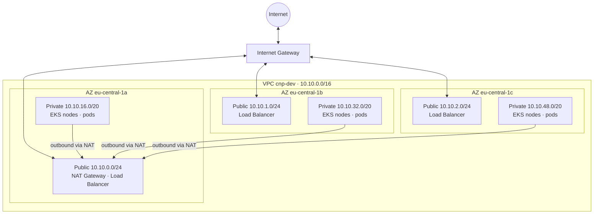

# Network – dev environment

VPC `10.10.0.0/16` in `eu-central-1`, three Availability Zones. See [ADR 0003](../adr/0003-network-design.md).

## Traffic flows

- **Customer → shop:** Internet → Internet Gateway → Load Balancer (public subnets) → frontend pods (private subnets)
- **Node → internet** (image pulls, AWS APIs): private subnet → NAT Gateway (AZ a) → Internet Gateway
- **Pod → pod:** directly inside the VPC, every pod has a VPC IP (AWS VPC CNI)

## Route tables

| Route table | Associated with | Default route `0.0.0.0/0` |
|---|---|---|
| public | all public subnets | Internet Gateway |
| private | all private subnets | NAT Gateway (dev: one shared) |
